# 🏥 Awesome Healthcare HIPAA Compliance Automation

<p align="center">
  
</p>

<p align="center">
  <a href="https://github.com/ishandutta2007/Awesome-Awesome-Awesome"></a>
  <a href="https://discord.gg/jc4xtF58Ve"></a>
  <a href="https://github.com/ishandutta2007/Awesome-Healthcare-Hipaa-Compliance-Automation/stargazers"></a>
  <a href="https://github.com/ishandutta2007/Awesome-Healthcare-Hipaa-Compliance-Automation/network/members"></a>
  <a href="https://github.com/ishandutta2007/Awesome-Healthcare-Hipaa-Compliance-Automation/blob/main/LICENSE"></a>
  <a href="https://github.com/ishandutta2007/Awesome-Healthcare-Hipaa-Compliance-Automation/pulls"></a>
  <a href="https://github.com/ishandutta2007"></a>
</p>

---

## 📑 Table of Contents
- [📌 Overview & SEO Highlights](#-overview--seo-highlights)
- [🌐 Sector Overview & Market Dynamics](#-sector-overview--market-dynamics)
- [💼 SaaS & Hosted Healthcare Compliance Platforms](#-saas--hosted-healthcare-compliance-platforms)
- [🔓 Open-Source GitHub Projects & Repositories](#-open-source-github-projects--repositories)
  - [📦 Standalone Healthcare Compliance Packages & Tools](#-standalone-healthcare-compliance-packages--tools)
- [🏗️ Recommended Architecture & Frameworks](#️-recommended-architecture--frameworks)
- [⭐ Star History](#-star-history)
- [🤝 How to Contribute](#-how-to-contribute)
- [⚖️ Disclaimer & Compliance Notice](#️-disclaimer--compliance-notice)

---

## 📌 Overview & SEO Highlights

Welcome to the definitive **Healthcare HIPAA Compliance Automation Ecosystem** guide. This repository is a curated collection of industry-leading **SaaS platforms**, **open-source security frameworks**, and **CI/CD compliance-as-code tools** tailored specifically for healthcare organizations, covered entities, Business Associates (BAs), digital health startups, and healthtech developers.

### 🔑 Key Search Keywords & Topics
`HIPAA Compliance Automation` • `Protected Health Information (PHI) Sanitization` • `De-Identification NLP` • `Healthcare GRC Platforms` • `Tamper-Evident Audit Logging` • `FHIR Security & Interoperability` • `EHR Access Auditing` • `Business Associate Agreement (BAA) Automation` • `HITECH & Omnibus Rule Readiness` • `DevSecOps Healthcare CI/CD Gates`

---

## 🌐 Sector Overview & Market Dynamics

The global **Healthcare Compliance Software & Automation Market** is valued at approximately **$4.0 billion to $4.37 billion in 2026** and is projected to expand at a compound annual growth rate (**CAGR of 11.0% to 13.8%**), surpassing **$13 billion by 2033**. Driven by escalating cyber threats, enforcement fines under the HIPAA Privacy and Security Rules, mandatory EHR interoperability standards (ONC/CMS), and the rapid emergence of generative AI in clinical workflows, continuous compliance automation has shifted from an annual audit exercise to an essential operational requirement.

From a market structure perspective, the healthcare compliance sector is **moderately to highly fragmented** rather than a winner-take-all monopoly. While major trust-management unicorns (such as Vanta and Drata) capture cross-industry baseline governance, the healthcare domain demands deep domain specialization—including FHIR schemas, HL7 parsers, EHR access audit streams, clinical de-identification, and medical device lifecycle compliance (FDA 21 CFR Part 11). Consequently, specialized healthtech GRC vendors, niche audit intelligence engines, and emerging open-source code scanners actively thrive alongside broader enterprise platforms, with strategic consolidation and M&A accelerating across the sector.

---

## 💼 SaaS & Hosted Healthcare Compliance Platforms

The table below summarizes leading commercial SaaS and hosted platforms for automated HIPAA compliance, risk assessment, continuous control monitoring, and evidence gathering. Entries are sorted descending by **Company Valuation / Scale**.

| Platform | Company Valuation / Revenue Scale | Primary Healthcare & HIPAA Focus | Starting Pricing Tier | Free Tier / Free Trial Limits |
| :--- | :--- | :--- | :--- | :--- |
| **[Vanta Healthcare](https://www.vanta.com/)** | **$4.2 Billion Valuation** (Series D, $150M+ ARR) | Enterprise Trust Management with continuous HIPAA, SOC 2, and HITRUST evidence gathering, employee training, and vendor risk tracking. | **$7,500 / year** (~$625/mo billed annually for startup Essentials single-framework tier) | **No free-forever tier**; offers a **14-day guided proof-of-concept (POC)** sandbox following sales qualification, limited to 1 framework and scoped cloud connectors. |
| **[Drata HIPAA](https://drata.com/)** | **$2.0 Billion Valuation** (Series C, $200M+ raised) | Continuous automated compliance monitoring, automated evidence collection, BAA vendor tracking, and auditor access portal. | **$7,500 / year** (~$625/mo billed annually for Foundation tier up to 50 employees) | **No free-forever tier**; provides a **14-day private proof-of-concept evaluation** upon demo completion, capped at 5 automated cloud/HR integrations. |
| **[Protenus](https://www.protenus.com/)** | **$84 Million Valuation** ($40M+ ARR, acquired by Bluesight) | AI-powered patient privacy monitoring, EHR audit log analytics, insider breach detection, and drug diversion prevention. | **$15,000 / year** (~$1,250/mo baseline entry subscription for regional health centers/clinics) | **No free-forever tier**; offers a **30-day guided health system pilot evaluation** with synthetic EHR data streams and up to 1,000 patient record audits. |
| **[Datica](https://datica.com/)** | **$50 Million Merged Valuation** (~$25M ARR, part of Lyniate/Aizon) | HIPAA-compliant cloud hosting infrastructure, managed Kubernetes with pre-configured BAAs, encrypted data storage, and audit logs. | **$11,988 / year** ($999/mo base managed compliant container cluster) | **No free-forever tier**; provides a **14-day sandbox cluster trial** upon technical screening, limited to 1 development node with test synthetic data. |
| **[Intraprise Health](https://intraprisehealth.com/)** | **$43 Million Acquisition** (Acquired by Health Catalyst, Nov 2024) | BluePrint Protect cybersecurity and HIPAA risk management software, third-party vendor assessments, and remediation tracking. | **$6,000 / year** (~$500/mo entry subscription for ambulatory health networks) | **No free-forever tier**; provides a **14-day sandbox access pass** upon introductory consultation, restricted to 1 organizational risk assessment template. |
| **[Compliancy Group](https://compliancy-group.com/)** | **~$30 Million Valuation** (~$10M ARR, acquired Healthicity 2026) | *The Guard* guided compliance automation platform, employee training, HIPAA audit defense coaching, and incident tracking. | **$99 / month + $8 / employee / month** (billed annually for Foundation tier) | **No free-forever tier**; provides a **14-day guided compliance audit consultation** with access to self-inspection checklists and 3 sample training seats. |
| **[MedStack](https://medstack.co/)** | **$15 Million Valuation** ($3.8M ARR, acquired by Launchit Solutions) | Compliance-as-code Docker/cloud infrastructure automation guaranteeing HIPAA and SOC 2 data protection at the container layer. | **$499 / month** ($5,988/yr for Exos compliance program; $1,199/mo for MedStack Control cloud engine) | **No free-forever tier**; offers a **14-day full platform trial** upon request, restricted to 1 non-production container service and 1 compliance policy package. |
| **[Accountable HQ](https://www.accountablehq.com/)** | **$12 Million Valuation** (~$3M ARR, 10,000+ organizations served) | End-to-end HIPAA compliance automation for startups, clinics, and business associates with risk reviews, employee training, and BAAs. | **$169 / month** (billed annually at $2,028/yr, or $199/mo billed monthly for Basic plan) | **7-day free trial** with **no credit card required**; full access to risk assessments, policy templates, and employee training modules for up to 5 team members. |
| **[HIPAAtrek](https://hipaatrek.com/)** | **$5 Million Valuation** (~$1.5M ARR, $1M venture funding) | Cloud-based HIPAA policy workflows, role-based staff training, automated business associate agreement logs, and task reminders. | **$4.99 / user / month** (Starter practitioner plan; comprehensive organization packages from $149/mo) | **14-day free trial**; enables up to 3 users to test policy customization, compliance task workflows, and automated notification triggers. |
| **[Gazelle Consulting](https://gazelleconsultingllc.com/)** | **$2.5 Million Revenue** (Boutique compliance advisory & automation) | Personalized HIPAA Security Risk Assessments (SRA), custom compliance manual generation, and fractional privacy officer support. | **$2,500 / project** (or ~$250/mo retainer for ongoing fractional compliance surveillance) | **No free-forever tier**; offers a **1-hour complimentary compliance posture consultation** with a preliminary high-level gap-analysis report. |

---

## 🔓 Open-Source GitHub Projects & Repositories

Explore vetted open-source security tools, de-identification libraries, GRC suites, and HIPAA scanners. Repositories are ranked descending by **GitHub Stars**, and each star badge links directly to that repository's Stargazers community.

1. **[Wazuh](https://github.com/wazuh/wazuh)** [](https://github.com/wazuh/wazuh/stargazers)  
   🛡️ *The Open Source Security Platform.* Unified XDR and SIEM protection providing out-of-the-box regulatory compliance mapping for **HIPAA**, PCI DSS, GDPR, and NIST 800-53. Automates log analysis, file integrity monitoring (FIM), vulnerability detection, and system audit trails required under HIPAA §164.312(b).

2. **[Lynis](https://github.com/CISOfy/lynis)** [](https://github.com/CISOfy/lynis/stargazers)  
   🔍 *Battle-tested security auditing & system hardening tool.* Agentless CLI scanner for Linux, macOS, and UNIX operating systems. Evaluates security defenses and system configurations against **HIPAA**, ISO 27001, and PCI DSS hardening baselines.

3. **[Presidio](https://github.com/data-privacy-stack/presidio)** [](https://github.com/data-privacy-stack/presidio/stargazers)  
   🧪 *Context-aware PII & PHI de-identification and anonymization SDK.* Developed by Microsoft / Data Privacy Stack. Features pluggable Named Entity Recognition (NER) models and rule-based recognizers to detect, redact, hash, mask, and pseudonymize 18 HIPAA Safe Harbor PHI categories in unstructured text and images.

4. **[Baserow](https://github.com/baserow/baserow)** [](https://github.com/baserow/baserow/stargazers)  
   📊 *Open-source no-code database & application builder.* Self-hostable Airtable alternative with enterprise role-based access control, audit logging, database encryption, and self-hosting options enabling **HIPAA, GDPR, and SOC 2** compliant data workflows.

5. **[Cloud Custodian](https://github.com/cloud-custodian/cloud-custodian)** [](https://github.com/cloud-custodian/cloud-custodian/stargazers)  
   ☁️ *Rules engine for cloud security, governance, and compliance.* Enables lightweight YAML policies to continuously audit, enforce encryption-at-rest (§164.312(a)(2)(iv)), and remediate non-compliant AWS, Azure, and GCP resources for HIPAA cloud environments.

6. **[OpenMed](https://github.com/maziyarpanahi/openmed)** [](https://github.com/maziyarpanahi/openmed/stargazers)  
   🧠 *Local-first healthcare AI with clinical NER and HIPAA PHI de-identification.* High-performance offline ML framework supporting 2,200+ medical models across Python, MLX, Android, and web runtimes to detect and redact medical entities without leaking PHI to external APIs.

7. **[OpenEMR](https://github.com/openemr/openemr)** [](https://github.com/openemr/openemr/stargazers)  
   🏥 *The most widely adopted open-source Electronic Health Record (EHR) & medical management system.* ONC-certified with granular role-based access controls (RBAC), electronic prescribing, encrypted records, and HIPAA-compliant system activity logging.

8. **[CISO Assistant](https://github.com/intuitem/ciso-assistant-community)** [](https://github.com/intuitem/ciso-assistant-community/stargazers)  
   📋 *Comprehensive open-source GRC platform.* Covers risk assessments, application security, audit evidence tracking, and policy mapping. Supports 100+ security frameworks out-of-the-box including **HIPAA**, NIST CSF, ISO 27001, SOC 2, and GDPR with automatic control cross-mapping.

9. **[Medplum](https://github.com/medplum/medplum)** [](https://github.com/medplum/medplum/stargazers)  
   ⚡ *Headless healthcare platform & FHIR backend engine.* Provides a developer-friendly API, compliant identity management, patient portals, and automated audit trails designed from the ground up for HIPAA and SOC 2 regulated health applications.

10. **[HAPI FHIR](https://github.com/hapifhir/hapi-fhir)** [](https://github.com/hapifhir/hapi-fhir/stargazers)  
    🔥 *The complete open-source FHIR implementation in Java.* Powers healthcare interoperability, secure HL7/FHIR storage, patient data provenance, and HIPAA-compliant healthcare data exchange worldwide.

11. **[TrueVault HIPAA Developer Guide](https://github.com/truevault-safe/hipaa-compliance-developers-guide)** [](https://github.com/truevault-safe/hipaa-compliance-developers-guide/stargazers)  
    📖 *Developer blueprint for HIPAA compliance & secure application engineering.* Detailed technical patterns for encryption keys, transmission security, data backup, and physical safeguards for software teams.

12. **[Comply](https://github.com/strongdm/comply)** [](https://github.com/strongdm/comply/stargazers)  
    📝 *SOC 2 and HIPAA compliance automation CLI.* Markdown-driven compliance-as-code management tool that automates policy publication, employee acknowledgments, and recurring compliance tickets.

13. **[Parse-HIPAA](https://github.com/netreconlab/parse-hipaa)** [](https://github.com/netreconlab/parse-hipaa/stargazers)  
    🔒 *HIPAA & GDPR compliant Parse Server stack.* Includes Docker configurations, PostgreSQL/MongoDB setups, and integration with ParseCareKit for building secure digital health and mobile medical apps.

14. **[PhantomTrace](https://github.com/vabhishek6/PhantomTrace)** [](https://github.com/vabhishek6/PhantomTrace/stargazers)  
    ⚡ *High-speed Rust detection & masking engine.* Scans log streams and text for PCI, PII, and PHI, providing tokenization and audit logs with microsecond latency.

15. **[DeIDClinic](https://github.com/angelpaulml17/DeIDClinic)** [](https://github.com/angelpaulml17/DeIDClinic/stargazers)  
    🩺 *Clinical text de-identification using BioBERT and ClinicalBERT.* Transformer-driven PHI detection pipeline tailored for hospital discharge notes and clinical summaries.

16. **[MCP-HIPAA](https://github.com/Gautam-Galada/MCP-HIPAA)** [](https://github.com/Gautam-Galada/MCP-HIPAA/stargazers)  
    🤖 *HIPAA-compliant medical AI agent using the Model Context Protocol (MCP).* Features local LLM inference, role-based data masking, and secure medical imaging workflows.

17. **[Verification-Layer (vlayer)](https://github.com/Francosimon53/verification-layer)** [](https://github.com/Francosimon53/verification-layer/stargazers)  
    🔬 *HIPAA compliance code scanner with 140+ AST security rules.* Includes CI/CD integrations, a VS Code extension with real-time save scanning, and optional AI-assisted false-positive reduction.

18. **[DataGovernanceWorkflow](https://github.com/amr-yasser226/DataGovernanceWorkflow)** [](https://github.com/amr-yasser226/DataGovernanceWorkflow/stargazers)  
    🔄 *Automated healthcare data governance pipeline.* Implements automated data classification, encryption key rotation, and GDPR/HIPAA compliance validation.

19. **[baadiff](https://github.com/cognis-digital/baadiff)** [](https://github.com/cognis-digital/baadiff/stargazers)  
    🛡️ *HIPAA Security Rule readiness scanner for codebases.* Evaluates source code across 5 HIPAA categories and 140+ rules (§164.312 Access Control, Audit Logs, Encryption). Air-gapped CI safe with zero network calls and MCP server integration.

20. **[Aegis](https://github.com/RastinAghighi/Aegis)** [](https://github.com/RastinAghighi/Aegis/stargazers)  
    🤖 *AI-native HIPAA code auditor powered by IBM Bob & MCP.* Exposes 6 compliance auditing tools over MCP to scan repositories, verify encryption, and generate auditor-ready evidence.

21. **[HippocratAI](https://github.com/sparkybug/hippocrat-ai)** [](https://github.com/sparkybug/hippocrat-ai/stargazers)  
    🩺 *Multi-agent clinical compliance reviewer for PRs.* Deploys 5 specialized review agents checking regulatory compliance (HIPAA, FDA 21 CFR Part 11, FHIR R4) before code gets merged.

22. **[Healthcare Record Manager](https://github.com/JukaleManmath/Healthcare-Record-Manager)** [](https://github.com/JukaleManmath/Healthcare-Record-Manager/stargazers)  
    ☁️ *AWS-native healthcare record automation platform.* Built with Flask, PostgreSQL, Docker, CloudFormation, and automated HIPAA audit logging.

23. **[QMTRY Compliance Monitoring](https://github.com/dallen91801/QMTRY-Healthcare-Compliance-Monitoring)** [](https://github.com/dallen91801/QMTRY-Healthcare-Compliance-Monitoring/stargazers)  
    📈 *Audit-ready healthcare compliance pipeline.* Combines dbt, Great Expectations, and Streamlit with GitHub Actions to produce downloadable evidence packs for CMS, HIPAA, and HEDIS.

---

### 📦 Standalone Healthcare Compliance Packages & Tools

The following specialized packages provide modular building blocks for HIPAA CI/CD pipelines, package registries, and research workflows:

*   🐍 **[phi-guard](https://pypi.org/project/phi-guard/)** (Python / PyPI) — CI/CD scanner for healthcare data ("gitleaks for PHI"). Features pre-commit regex hooks (<3 sec execution) and deep NLP inspection via Microsoft Presidio detecting 17 of 18 HIPAA PHI identifiers with SARIF reporting.
*   🧪 **[Health-DeID](https://pypi.org/project/health-deid/)** (Python / PyPI) — Resumable, auditable de-identification engine for clinical text. Supports multi-model backends (AWS Comprehend Medical, Claude on Amazon Bedrock, local rules) with SQLite audit trails.
*   🏥 **[FHIR-READA](https://pypi.org/project/fhir-reada/)** (Python / PyPI) — FHIR Research Extractor and De-identified Analyzer CLI tool for extracting, pseudonymizing, and filtering patient datasets from any FHIR R4 server.
*   📊 **[regulog](https://cran.r-project.org/web/packages/regulog/)** (R / CRAN) — Tamper-evident audit logging for regulated environments. Implements cryptographic SHA-256 hash chains and UTC timestamps meeting HIPAA §164.312(b) and FDA 21 CFR Part 11 standards.
*   ☕ **[hipaa-audit](https://www.npmjs.com/package/hipaa-audit)** (Node.js / npm) — Command-line tool scanning 15+ file formats for unencrypted tokens, secrets, and HIPAA violations with a 0–100 compliance health score.

---

## 🏗️ Recommended Architecture & Frameworks

To establish a zero-trust, automated HIPAA compliance posture without third-party vendor lock-in, combine these complementary open-source components:

```
┌────────────────────────────────────────────────────────┐
│               Developer Code / Git Commit              │
└───────────────────────────┬────────────────────────────┘
                            │
                            ▼
┌────────────────────────────────────────────────────────┐
│             Pre-Commit & CI/CD Pipeline                │
│  • baadiff (HIPAA §164.312 Security Rule Scanner)      │
│  • phi-guard (17 PHI Identifiers Regex & Presidio NLP) │
│  • Lynis (OS & Container Hardening Verification)       │
└───────────────────────────┬────────────────────────────┘
                            │
                            ▼
┌────────────────────────────────────────────────────────┐
│            Data Processing & Persistence Layer         │
│  • Health-DeID / Presidio (Clinical PHI Redaction)     │
│  • Medplum / HAPI FHIR (Encrypted FHIR R4 Storage)     │
│  • regulog (SHA-256 Tamper-Evident Hash Chain Logs)    │
└───────────────────────────┬────────────────────────────┘
                            │
                            ▼
┌────────────────────────────────────────────────────────┐
│         Continuous GRC & Evidence Aggregation          │
│  • CISO Assistant (Unified Control Cross-Mapping)      │
│  • Wazuh (Real-time SIEM & System Activity Auditing)   │
└────────────────────────────────────────────────────────┘
```

---

## ⭐ Star History

[](https://star-history.dera.page/#ishandutta2007/Awesome-Healthcare-Hipaa-Compliance-Automation&type=date&legend=top-left)

---

## 🤝 How to Contribute

We actively welcome contributions from healthcare privacy engineers, compliance officers, and software developers!

1. 🍴 **Fork the repository** on GitHub.
2. 🌿 **Create a dedicated branch**: `git checkout -b add/my-awesome-tool`.
3. 📝 **Add or update entries** in `README.md` following the established table / list schema.
4. 🔗 **Ensure links are direct, active, and factual** with official documentation or repo links.
5. 🚀 **Submit a Pull Request (PR)** with a concise description of the tool and its healthcare compliance relevance.

If this curated ecosystem helps your organization stay compliant and secure, please give us a **Star** ⭐!

---

## ⚖️ Disclaimer & Compliance Notice

- ℹ️ This repository is a community-curated technical directory and does not constitute formal legal advice, compliance certification, or regulatory endorsement.
- 📜 Handling Protected Health Information (PHI) and Electronic Protected Health Information (ePHI) requires compliance with the **HIPAA Privacy, Security, and Breach Notification Rules (45 CFR Parts 160 and 164)**, the **HITECH Act**, and applicable federal/state mandates.
- 🛡️ Passing an automated code scan or utilizing a compliance platform does not replace institutional risk assessments (§164.308(a)(1)(ii)(A)), qualified legal counsel, workforce security training, or signed Business Associate Agreements (BAAs).
- 🧩 Open-source tools provide modular building blocks (e.g. Presidio for redaction, Wazuh for SIEM, regulog for audit trails). Organizations remain legally responsible for implementing defense-in-depth, key management, and continuous organizational safeguards.

---

<p align="center">
  <b>Built for healthcare developers, privacy officers, and security engineers advancing transparent compliance automation. 🚀</b>
</p>
